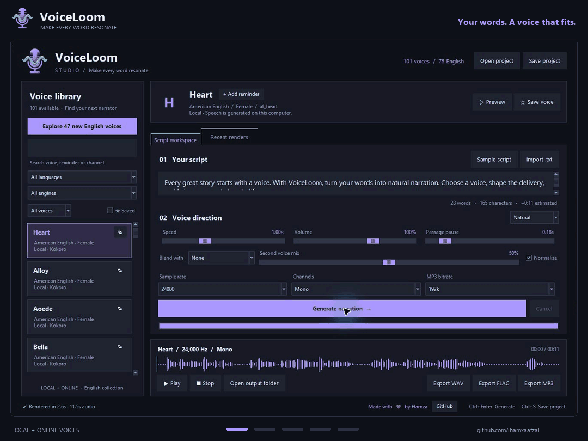

<p align="center">
  
</p>

# VoiceLoom

**Turn your scripts into natural narration.** A Windows desktop text-to-speech studio with 54 local Kokoro voices, 47 online English voices, voice blending, waveform playback, and WAV/FLAC/MP3 export.

**[Download Windows Setup ZIP](https://github.com/ihamxaafzal/VoiceLoom/releases/latest/download/VoiceLoom-Setup-1.0.0-Windows-x64.zip)** · [Release notes](https://github.com/ihamxaafzal/VoiceLoom/releases/latest) · [Installation guide](WINDOWS-INSTALLATION.md)

**No Python or separate library installation required.** The Windows installer includes its own Python runtime, speech dependencies, Kokoro AI model, 54 local voice files, pronunciation resources, and FFmpeg.

Made with love by [Hamza](https://github.com/ihamxaafzal).

## Install on Windows

1. Download **VoiceLoom-Setup-1.0.0-Windows-x64.zip** from the [latest release](https://github.com/ihamxaafzal/VoiceLoom/releases/latest).
2. Right-click the ZIP and choose **Extract All**.
3. Double-click **VoiceLoom-Setup-1.0.0-Windows-x64.exe** and follow the installation wizard.
4. Open **VoiceLoom** from the Start menu or the optional desktop shortcut.

| Requirement | Windows installer |
| --- | --- |
| Operating system | Windows 10 or Windows 11, 64-bit |
| Memory | 8 GB RAM recommended |
| Free disk space | At least 4 GB recommended for download, extraction, and installation; allow more for recordings |
| Download | Approximately 760 MiB; the local AI model is included |
| Python / pip / libraries | Included; no separate installation |
| NVIDIA GPU | Not required; the packaged release runs on CPU |
| Internet | Needed to download the installer and use online voices; bundled local voices work offline |

Use the **Setup ZIP** under release **Assets**. GitHub's **Code > Download ZIP** and automatically generated **Source code** archives contain the project source, not the Windows installer.

The installer is currently unsigned, so Windows may show a publisher warning. Release checksums are provided for integrity verification. See the [installation guide](WINDOWS-INSTALLATION.md) for details.

## Preview



Browse the voice library, compose a script, generate narration, and review the waveform before exporting.

## Features

- **101 voices:** 54 local Kokoro voices and 47 online English voices, including 75 English voices across local and online engines.
- **Multilingual local narration:** American/British English, Spanish, French, Hindi, Italian, Japanese, Brazilian Portuguese, and Mandarin Chinese.
- **Voice discovery:** searchable library, favorites, and private channel/reminder labels.
- **Delivery controls:** speed, volume, passage pauses, normalization, sample rate, mono/stereo output, and presets.
- **Voice blending:** mix compatible local voices from the same language.
- **Playback workspace:** script import, word counts, waveform display, preview, playback, and click-to-seek.
- **Audio export:** WAV, FLAC, and MP3; FFmpeg is included in the Windows installer.
- **Projects and sessions:** save JSON projects, restore sessions, and revisit recent renders.

Use text in the selected voice's language. Kokoro has no native Urdu voice; Hindi voices expect Hindi text rather than Urdu or Roman Urdu. Presets adjust speed and pauses; they do not control model emotion.

## Using VoiceLoom

1. Choose a voice and write or import your script.
2. Select **Preview** to hear the voice's sample sentence.
3. Adjust delivery, output settings, or a preset.
4. Select **Generate narration**, then review the waveform and playback.
5. Export your audio or save the project to continue later.

| Shortcut | Action |
| --- | --- |
| Ctrl+Enter | Generate narration |
| Ctrl+S | Save project |
| Ctrl+O | Open project |

Local synthesis uses the bundled model on your computer. Online Edge voices send the selected script to Microsoft's speech service and require an internet connection. Availability depends on that service; the included online voice catalog is a snapshot.

## Recordings, settings, and updates

For the installed Windows app, settings, recordings, and logs are stored in:

```text
%LOCALAPPDATA%\VoiceLoom
```

The default application location is `%LOCALAPPDATA%\Programs\VoiceLoom`. Installation is per user and does not require administrator privileges. Updates and uninstall preserve the user data folder. Saved project files remain wherever you chose to save them.

For source-based runs, the existing default remains `studio_data/` beside `app.py`. Private reminder labels are not included in speech requests. Stereo output duplicates the mono source; changing output sample rate resamples the audio.

## Troubleshooting

| Problem | What to check |
| --- | --- |
| Download contains Python files but no installer | Download the **Setup ZIP** from release Assets, then extract it |
| First launch takes a little time | Allow the CPU speech model to load; the bundled model does not need to download |
| Installed app cannot start | Inspect `%LOCALAPPDATA%\VoiceLoom\logs\startup.log`; reinstall if application files are missing |
| Online voice fails | Check your internet connection and service availability, or choose a local voice |
| Playback is silent | Check the Windows output device and system volume |
| More space is needed | Allow room for the ZIP, extracted setup, installed app, and generated audio |
| Source setup fails | Read `logs/setup.log` and run `diagnose.bat` |

If you report a problem, include your Windows version, selected voice, and relevant error text. Remove private scripts or personal information from logs before sharing them.

## Run from source

The installer is the recommended route for normal Windows use. Developers can still run the Python project directly.

Requirements: Python 3.10-3.12 **64-bit** with pip, venv, and Tcl/Tk; Python 3.12 is recommended. Python 3.13 and newer are rejected by the source launcher checks.

```powershell
git clone https://github.com/ihamxaafzal/VoiceLoom.git
cd VoiceLoom
.\setup.bat
.\start.bat
```

`setup.bat` creates `.venv`, installs CPU PyTorch and `requirements.txt`, and checks imports. The source route needs internet for package installation and its first local model/voice downloads. Run setup on each computer; do not copy virtual environments between PCs.

Manual setup:

```powershell
py -3.12 -m venv .venv
.\.venv\Scripts\python.exe -m pip install --upgrade pip
.\.venv\Scripts\python.exe -m pip install torch --index-url https://download.pytorch.org/whl/cpu
.\.venv\Scripts\python.exe -m pip install -r requirements.txt
.\.venv\Scripts\python.exe launcher.py --check
.\.venv\Scripts\python.exe launcher.py
```

For source installations, [eSpeak NG](https://github.com/espeak-ng/espeak-ng/releases) may be needed for non-English phonemization, and [FFmpeg](https://ffmpeg.org/download.html) must be available on `PATH` for MP3 export. Those resources are included in the packaged Windows release. For optional CUDA acceleration in a source environment, follow the official [PyTorch installer selector](https://pytorch.org/get-started/locally/) and install a matching driver and PyTorch build.

## Development and Windows packaging

```powershell
.\.venv\Scripts\python.exe -m unittest test_launcher test_studio -v
.\.venv\Scripts\python.exe app.py --ui-only
```

The regression suite uses a synthetic pipeline and mocked online requests. The packaged release was also checked with real offline synthesis in all nine language groups, audio conversion, native app launch, installation, and uninstall. A separate clean Windows VM and live online synthesis were not tested.

[BUILD-WINDOWS.md](BUILD-WINDOWS.md) explains the private-runtime packaging process. [CHANGELOG.md](CHANGELOG.md) records release changes. Large executable installers and model binaries are distributed through **GitHub Releases**, keeping the source repository lightweight.

## License and third-party components

Original VoiceLoom code and documentation are licensed under **Apache-2.0**; see [LICENSE](LICENSE) and [NOTICE](NOTICE). This license does not relicense third-party models, voices, libraries, native binaries, or online services.

The Windows package contains components with their own Apache, BSD, PSF, GPL, LGPL, MIT, and other terms. See [THIRD_PARTY_NOTICES.md](THIRD_PARTY_NOTICES.md) and [FFMPEG-SOURCE.md](FFMPEG-SOURCE.md). Download the accompanying [license and attribution archive](https://github.com/ihamxaafzal/VoiceLoom/releases/download/v1.0.0/VoiceLoom-1.0.0-Licenses.zip) and [FFmpeg core source snapshot](https://github.com/ihamxaafzal/VoiceLoom/releases/download/v1.0.0/FFmpeg-239f2c733d-core-source.zip) from Releases. The core snapshot is not a complete corresponding-source bundle for FFmpeg's statically linked external libraries; that source coverage has not been fully audited.

VoiceLoom does not claim ownership of third-party voices or endorsement by their providers. Online-service terms remain separate from the source-code licenses.

## Acknowledgments

VoiceLoom uses [Kokoro](https://github.com/hexgrad/kokoro), the [Kokoro-82M model](https://huggingface.co/hexgrad/Kokoro-82M), [Misaki](https://github.com/hexgrad/misaki), [edge-tts](https://github.com/rany2/edge-tts), PyTorch, FFmpeg, and other open-source libraries. Upstream components and model assets retain their respective licenses and service terms. The installer includes third-party notices and a package inventory.

For questions or feedback, [open an issue](https://github.com/ihamxaafzal/VoiceLoom/issues) or visit [Hamza's profile](https://github.com/ihamxaafzal).
